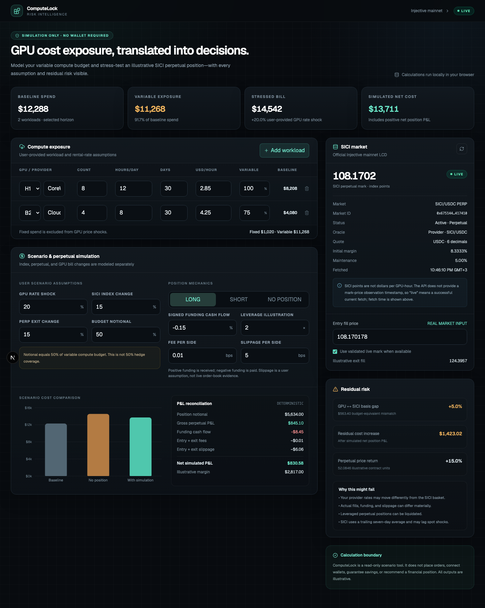
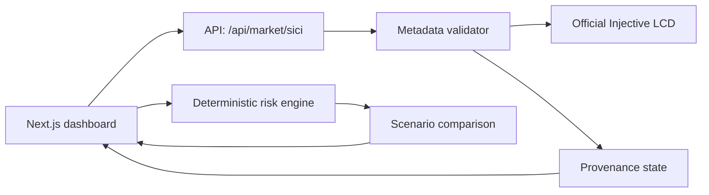

# ComputeLock

**GPU compute cost risk analysis and SICI perpetual simulation on Injective.**

ComputeLock turns a planned GPU workload into a transparent cost exposure, then compares the stressed compute bill with an illustrative SICI perpetual position. It is a read-only scenario tool: no wallet, authentication, custody, order signing, or execution is present.



## What works today

- Multi-row GPU exposure builder with provider, model, quantity, utilization, horizon, rental rate, and fixed/variable price share.
- Deterministic baseline and stressed compute-cost calculations.
- Read-only integration with the official Injective mainnet LCD.
- Fail-closed validation of the SICI market ID, status, perpetual flag, quote denomination/decimals, and oracle metadata.
- Separate GPU-price, SICI-index, and SICI-perpetual scenarios so basis risk is not hidden.
- Long, short, and no-position comparisons using entry and exit fill prices.
- Signed funding cash flow, two-sided fees, two-sided slippage, margin illustration, and net P&L reconciliation.
- Explicit `LIVE`, `STALE`, and `UNAVAILABLE` provenance states. No demo price is silently substituted for unavailable live data.
- Responsive fintech dashboard, unit tests, browser-flow tests, and Vercel-ready Next.js output.

## Verified SICI market

The adapter currently expects the following mainnet identity, verified against the official Injective LCD on November 11, 2026:

| Field | Expected value |
| --- | --- |
| Ticker | `SICI/USDC PERP` |
| Market ID | `0x6751442adea73a2b65adce484dd7bde25d204c9695fc9d5410933171f3417410` |
| Status | `Active` |
| Instrument | Perpetual |
| Quote denomination | `erc20:0xa00C59fF5a080D2b954d0c75e46E22a0c371235a` |
| Quote decimals | `6` |
| Oracle | `Provider` |
| Oracle base / quote | `SICI/USDC` / `InjectiveLabs` |
| Oracle scale factor | `6` |

The application validates every field before accepting the returned mark price. If validation fails, the UI reports the market as unavailable. A configured market identity is deliberately safer than trusting ticker-only discovery.

Source endpoint:

```text
https://lcd.injective.network/injective/exchange/v1beta1/derivative/markets
```

SICI points are a rebased basket index—not USD per GPU-hour. The LCD response does not expose a mark-price observation timestamp, so the UI shows the application fetch timestamp and explains that limitation.

## Financial model

For workload row `i`:

```text
baseline_i = gpu_count_i × hours_per_day_i × days_i × usd_per_gpu_hour_i
variable_i = baseline_i × variable_price_share_i
shocked_i  = fixed_i + variable_i × (1 + gpu_price_shock_i)
```

The perpetual simulation uses the tradable perpetual entry and exit prices rather than treating index return as realized perpetual return:

```text
direction = +1 long, -1 short
quantity = position_notional_usd / entry_fill_price
gross_pnl = direction × quantity × (exit_fill_price - entry_fill_price)

net_pnl = gross_pnl
        + signed_funding_cash_flow
        - entry_fee - exit_fee
        - entry_slippage - exit_slippage

simulated_net_compute_cost = shocked_compute_bill - net_pnl
```

Positive funding cash flow means funding received; negative means funding paid. Fees and slippage are nonnegative costs. “Notional equal to 50% of variable budget” is not described as 50% hedge coverage because actual effectiveness depends on basis, timing, liquidity, and execution.

All money calculations use `decimal.js`; formatting and charting happen after deterministic outputs are produced.

## Architecture



```text
src/
  app/
    api/market/sici/route.ts   Read-only server adapter
    page.tsx                   Dashboard entry
  components/dashboard.tsx    Interactive risk cockpit
  lib/
    calculations.ts           Pure deterministic financial functions
    injective.ts              Fetch, validation, normalization, stale fallback
    market-config.ts           Reviewed SICI market identity
    types.ts                   Domain contracts
e2e/                           Playwright critical-flow tests
docs/PRODUCT_REQUIREMENTS.md   Updated product requirements
```

## Local setup

Requirements: Node.js 20.9+ and npm.

```bash
git clone https://github.com/karagozemin/ComputeLock.git
cd ComputeLock
npm install
cp .env.example .env.local
npm run dev
```

Open `http://localhost:3000`.

The default official LCD endpoint can be overridden:

```bash
INJECTIVE_LCD_URL=https://lcd.injective.network
```

## Verification

```bash
npm run lint
npm run test
npm run test:e2e
npm run build
```

Unit tests cover fixed/variable spend, cost shocks, long and short P&L, signed funding, fees, slippage, no-position behavior, basis gaps, atomic-unit conversion, and fail-closed market validation. Playwright covers initial market rendering, scenario recalculation, and workload creation.

## Deploying to Vercel

The project uses the standard Next.js App Router and requires no database or secrets for P0.

1. Import the GitHub repository into Vercel.
2. Keep the framework preset as **Next.js**.
3. Optionally set `INJECTIVE_LCD_URL`; otherwise the official default is used.
4. Deploy and verify `/api/market/sici` before sharing the URL.

The server route uses `no-store` and an eight-second upstream timeout. A warm runtime may return the last previously validated snapshot as `STALE` for up to 24 hours; otherwise it returns `UNAVAILABLE` without a fabricated price.

## Safety and limitations

- ComputeLock is scenario analysis, not investment advice or a recommendation.
- It does not place real or simulated orders on Injective; “simulation” means local arithmetic only.
- No result represents guaranteed savings or guaranteed hedge effectiveness.
- The SICI basket and seven-day smoothing can diverge from a specific provider invoice.
- Funding, fills, liquidity, fees, liquidation mechanics, and GPU usage can differ from user assumptions.
- Margin shown is an illustration (`notional ÷ leverage`), not an exchange liquidation calculation.
- The current MVP does not ingest cloud bills, estimate empirical hedge ratios, or backtest historical effectiveness.

## Highest-impact P1 work

1. **Read-only SICI history and funding series** with source timestamps, gaps, and licensed provenance.
2. **Order-book liquidity diagnostics** to replace user-entered slippage with size-aware execution scenarios.
3. **Saved and exportable risk reports** containing inputs, market snapshot, formulas, and disclosures.
4. **CSV workload import** for real FinOps data without requiring account integrations.
5. **Empirical basis analysis** only after representative provider-rate and SICI histories are available.

Generative AI explanations remain intentionally deferred until the financial engine and evidence pipeline are stable.

## Product documentation

See [Product Requirements](docs/PRODUCT_REQUIREMENTS.md) for scope, acceptance criteria, risks, and the corrected P&L methodology.

## License

No open-source license has been selected yet. All rights reserved by the repository owner.
